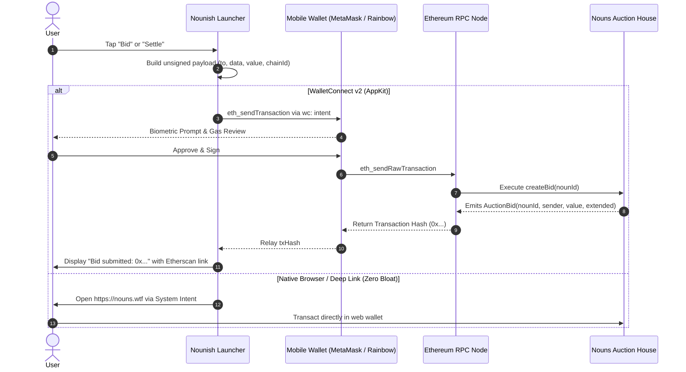

# Nouns DAO On-Chain Write Transactions & Payload Specification

This document specifies how **Nounish Launcher** can construct unsigned transaction payloads for on-chain write interactions with the canonical Nouns Auction House contract on Ethereum Mainnet.

---

## Contract Reference

- **Contract Name**: `NounsAuctionHouseProxy` (ERC-1967 Transparent Upgradeable Proxy)
- **Target Address**: [`0x830bd73e4184cef73443c15111a1df14e495c706`](https://etherscan.io/address/0x830bd73e4184cef73443c15111a1df14e495c706)
- **Network**: Ethereum Mainnet (`chainId: 1` / `0x1`)
- **Key Write Functions**:
  - `createBid(uint256 nounId)` (`payable`)
  - `settleCurrentAndCreateNewAuction()` (`nonpayable`)

---

## The launcher generates the unsigned transaction payload:

When initiating an on-chain write action (such as placing a bid on the active daily Noun or triggering auction settlement), the launcher constructs a standards-compliant **EIP-1559 / EIP-1193** unsigned transaction payload:

```json
{
  "from": "0xUserWalletAddressHere",
  "to": "0x830bd73e4184cef73443c15111a1df14e495c706",
  "value": "0x7ce66c50e2840000",
  "data": "0x1998aeef0000000000000000000000000000000000000000000000000000000000000816",
  "gas": "0x1d4c0",
  "chainId": "0x1"
}
```

### Breakdown of Fields:

1. **`to`** (`string`, 20-byte Ethereum address):
   - Always points to the Nouns Auction House proxy contract:
     `0x830bd73e4184cef73443c15111a1df14e495c706`
2. **`from`** (`string`, 20-byte Ethereum address):
   - The user's active account address retrieved through the WalletConnect / AppKit session handshake or deep-link callback.
3. **`value`** (`string`, hex-encoded quantity in Wei):
   - For **`createBid(nounId)`**: The bid amount in Wei converted to hexadecimal.
     - *Example*: 9.0 ETH = $9 \times 10^{18}$ Wei = `9000000000000000000` Wei = `0x7ce66c50e2840000`.
   - For **`settleCurrentAndCreateNewAuction()`**: `0x0` (no ETH is sent).
4. **`data`** (`string`, ABI-encoded function call):
   - The 4-byte Keccak-256 method selector followed by tightly packed, 32-byte padded parameter arguments.
5. **`gas` / `gasLimit`** (`string`, hex-encoded quantity, optional):
   - Estimated gas units needed for execution (typically ~`120,000` / `0x1d4c0` for bids; ~`350,000` / `0x55730` for settlement). Can be omitted to let the user's wallet simulate and determine the exact gas limit.
6. **`chainId`** (`string`, hex-encoded integer):
   - `0x1` for Ethereum Mainnet (prevents replay attacks on testnets or L2 forks).

---

## Function ABI Encodings

### 1. `createBid(uint256 nounId)`

- **Function Signature**: `createBid(uint256)`
- **Keccak-256 Hash**: `1998aeef36585ea150c9966efaa32661ab2032e2c4cda53412a819c9e78cc828`
- **4-Byte Selector**: `0x1998aeef`
- **Argument 1 (`nounId`)**: 32-byte big-endian unsigned integer (64 hex characters).

#### Example: Bidding on Noun #2070 (`0x816`)
- `nounId`: `2070` = `0x816`
- 32-byte padded argument:
  `0000000000000000000000000000000000000000000000000000000000000816`
- **Full Calldata (`data`)**:
  ```
  0x1998aeef0000000000000000000000000000000000000000000000000000000000000816
  ```

---

### 2. `settleCurrentAndCreateNewAuction()`

- **Function Signature**: `settleCurrentAndCreateNewAuction()`
- **Keccak-256 Hash**: `217d092285189280d4fbb1c775d7e7e604313f8c5b3648f074d32a19fa620f3e`
- **4-Byte Selector**: `0x217d0922`
- **Arguments**: None (0 parameters).
- **Full Calldata (`data`)**:
  ```
  0x217d0922
  ```
- **Transaction Value (`value`)**: `0x0`

---

## Transaction Dispatch Architectures



---

## Kotlin Payload Generator (Zero Dependencies)

The launcher can generate this payload natively using built-in Java/Kotlin standard libraries without bundling heavy Web3 SDKs:

```kotlin
package com.nounish.launcher.data

import java.math.BigInteger

object NounsTransactionBuilder {

    const val NOUNS_AUCTION_HOUSE_PROXY = "0x830bd73e4184cef73443c15111a1df14e495c706"
    const val METHOD_CREATE_BID = "0x1998aeef"
    const val METHOD_SETTLE = "0x217d0922"
    const val ETHEREUM_MAINNET_CHAIN_ID = "0x1"

    data class UnsignedTransactionPayload(
        val to: String,
        val from: String? = null,
        val value: String,
        val data: String,
        val chainId: String = ETHEREUM_MAINNET_CHAIN_ID,
        val gas: String? = null
    ) {
        fun toJsonRpcParams(): String {
            val fromPart = if (from != null) "\"from\": \"$from\", " else ""
            val gasPart = if (gas != null) ", \"gas\": \"$gas\"" else ""
            return """
                {
                    ${fromPart}"to": "$to",
                    "value": "$value",
                    "data": "$data",
                    "chainId": "$chainId"$gasPart
                }
            """.trimIndent()
        }
    }

    /**
     * Builds an unsigned payload for `createBid(uint256 nounId)`.
     * @param nounId The token ID being auctioned (e.g. 2070).
     * @param bidEth The bid amount in ETH (e.g. 9.0).
     * @param userAddress The sender's Ethereum account address (optional).
     */
    fun buildBidPayload(
        nounId: Int,
        bidEth: Double,
        userAddress: String? = null
    ): UnsignedTransactionPayload {
        val nounIdHex = BigInteger.valueOf(nounId.toLong())
            .toString(16)
            .padStart(64, '0')

        val weiMultiplier = BigInteger("1000000000000000000") // 10^18
        val weiAmount = (bidEth * 1e18).toLong()
        val valueHex = "0x" + BigInteger.valueOf(weiAmount).toString(16)

        return UnsignedTransactionPayload(
            to = NOUNS_AUCTION_HOUSE_PROXY,
            from = userAddress,
            value = valueHex,
            data = METHOD_CREATE_BID + nounIdHex,
            gas = "0x1d4c0" // 120,000 gas limit baseline
        )
    }

    /**
     * Builds an unsigned payload for `settleCurrentAndCreateNewAuction()`.
     */
    fun buildSettlePayload(userAddress: String? = null): UnsignedTransactionPayload {
        return UnsignedTransactionPayload(
            to = NOUNS_AUCTION_HOUSE_PROXY,
            from = userAddress,
            value = "0x0",
            data = METHOD_SETTLE,
            gas = "0x55730" // 350,000 gas limit baseline
        )
    }
}
```

---

## Safety & Validation Rules

1. **Minimum Bid Increment Verification**:
   - The contract enforces `reservePrice` (typically 0.15 ETH) if no bids exist, or `currentBid + (currentBid * minBidIncrementPercentage / 100)`.
   - The launcher should calculate and validate `bidAmount >= minNextBid` before generating the payload to prevent rejected transactions and wasted gas.
2. **Auction Settlement Window**:
   - `createBid` will revert if `block.timestamp >= auction.endTime` (auction has ended).
   - `settleCurrentAndCreateNewAuction` will revert if `block.timestamp < auction.endTime` (auction is still live).
3. **Zero Custody Guarantee**:
   - The launcher **never requests, stores, or handles private keys or seed phrases**. All signing is strictly delegated to the user's external hardware or mobile wallet via EIP-1193 / WalletConnect protocols.
