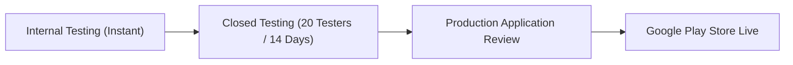

# Google Play Store Compliance & Publishing Guide

A comprehensive guide for publishing **Nounish Launcher** to the Google Play Store, detailing policy compliance, package visibility, data safety declarations, store listing requirements, and release workflows.

---

## Table of Contents

1. [Prerequisites & Google Play Developer Account](#1-prerequisites--google-play-developer-account)
2. [Package Visibility & Installed Apps Policy](#2-package-visibility--installed-apps-policy)
3. [Data Safety Form Declarations](#3-data-safety-form-declarations)
4. [Privacy Policy Requirements & Template](#4-privacy-policy-requirements--template)
5. [Accessibility Service & Lock Screen Compliance](#5-accessibility-service--lock-screen-compliance)
6. [Financial & Cryptocurrency Information Policy](#6-financial--cryptocurrency-information-policy)
7. [Technical & Build Requirements (AAB)](#7-technical--build-requirements-aab)
8. [Store Listing Assets & Metadata](#8-store-listing-assets--metadata)
9. [Content Rating (IARC Questionnaire)](#9-content-rating-iarc-questionnaire)
10. [Submission Checklist & Step-by-Step Rollout](#10-submission-checklist--step-by-step-rollout)

---

## 1. Prerequisites & Google Play Developer Account

Before initiating submission in the Google Play Console:

### Account Types
- **Personal Account**:
  > [!IMPORTANT]
  > For personal developer accounts created after **November 13, 2023**, Google requires a mandatory **Closed Testing phase with at least 20 testers opted-in for at least 14 consecutive days** before production access can be requested.
- **Organization Account**:
  > [!NOTE]
  > Organization accounts require a D-U-N-S number, verified organization legal identity, and official contact information, but are exempt from the 20-tester requirement.

### Registration Fee & Verification
- One-time registration fee: \$25 USD.
- Identity verification via government-issued photo ID and proof of address.
- Active public developer contact email and public website/policy URL.

---

## 2. Package Visibility & Installed Apps Policy

The most scrutinized aspect of any Android launcher on Google Play is **how it accesses and processes the list of installed applications**.

Google Play strictly regulates broad package visibility to safeguard user privacy against unauthorized app enumeration and profiling.

### Core Use Case Qualification
Google Play's **Package Visibility Policy** explicitly lists **Device search and launchers** as an authorized core use case:

> "Apps that have a core purpose to launch, search, or provide interoperability with other apps on the device may qualify for broad package visibility."

### Implementation in Nounish Launcher

Nounish Launcher implements two potential approaches to package visibility:

#### Approach A: The `<queries>` Intent Filter (Current Implementation)
In [AndroidManifest.xml](file:///f:/2026/nounishlauncher/app/src/main/AndroidManifest.xml#L7-L12):
```xml
<queries>
    <intent>
        <action android:name="android.intent.action.MAIN" />
        <category android:name="android.intent.category.LAUNCHER" />
    </intent>
</queries>
```
- **Why this matters for Play Store review**:
  - Does **not** request `android.permission.QUERY_ALL_PACKAGES`.
  - Only queries apps declaring a launcher activity (`CATEGORY_LAUNCHER`), matching the exact definition of a home screen replacement.
  - **Does not trigger the high-risk permission declaration form in Google Play Console**, significantly reducing review friction and the risk of automated rejections.
  - Fully compatible with `LauncherApps.getActivityList(null, userHandle)` for personal and work profiles.

#### Approach B: `QUERY_ALL_PACKAGES` Permission (If ever enabled)
If `android.permission.QUERY_ALL_PACKAGES` is ever added to [AndroidManifest.xml](file:///f:/2026/nounishlauncher/app/src/main/AndroidManifest.xml), Google Play Console will require completing the **Package Visibility Declaration Form**:

1. **Permitted Functionality Declaration**:
   - Select: **Launcher / Home screen app**.
2. **Core Purpose Description (Exact Submission Text)**:
   ```text
   Nounish Launcher is a replacement home screen and application launcher (declaring android.intent.category.HOME). Its fundamental core purpose is to display the device app drawer, populate user-pinned application shortcuts on the home screen, enable instant search across installed apps, support multi-profile / work profile apps via LauncherApps API, and launch user-selected applications. All package information is processed strictly on-device in local memory and private app cache. No package or usage data is transmitted over the network or shared with any third party.
   ```
3. **Video Demonstration Requirement**:
   - Google requires a direct URL (YouTube unlisted or Google Drive link) demonstrating:
     1. Setting Nounish Launcher as the default home app.
     2. Opening the app drawer showing the list of installed applications.
     3. Searching for an app and launching it.
     4. Pinning an app to the home screen.

### Data Handling Constraints
- **Strictly On-Device Processing**: [AppRepository.kt](file:///f:/2026/nounishlauncher/app/src/main/java/com/nounish/launcher/data/AppRepository.kt) reads package labels and caches them locally in `apps_cache.json` (`context.filesDir`).
- **Zero Transmission**: Package names, labels, or usage habits must **never** be transmitted via HTTP, WebSockets, or logs.
- **Pruning**: Uninstalled apps are automatically removed via `PackageChangeReceiver`.

---

## 3. Data Safety Form Declarations

All apps submitted to Google Play must complete the **Data Safety** questionnaire in Play Console.

Because Nounish Launcher is designed with zero telemetry, zero analytics, and zero tracking, the declarations are straightforward:

### Overview Question
- **Does your app collect or share any of the required user data types?**
  - **Answer: NO**
  - *Note*: Google defines "collection" as transmitting data off the device to a server. Processing installed apps locally on the device does **not** constitute data collection under Google Play's definition.

### Detailed Data Types Breakdown

| Category | Data Type | Collected? | Shared? | Explanation |
|---|---|---|---|---|
| **Location** | Approximate / Precise | No | No | No location APIs requested |
| **Personal Info** | Name, Email, User IDs | No | No | No account registration or profile |
| **Financial Info** | Payment info, Purchase history | No | No | No payments, purely free and open-source |
| **Health & Fitness** | Health / Fitness info | No | No | N/A |
| **Messages** | SMS, Emails, Chat | No | No | N/A |
| **Photos & Videos** | Photos / Videos | No | No | N/A |
| **Audio Files** | Voice / Sound recordings | No | No | N/A |
| **Files & Docs** | Files / Documents | No | No | Settings backups are saved locally via Android SAF under user control |
| **App Activity** | App interactions, In-app search | No | No | Search queries and app launches are processed strictly in RAM |
| **App Info & Performance** | Crash logs, Diagnostics | No | No | Zero crash reporting SDKs (no Firebase, no Sentry) |
| **Device or Other IDs** | Advertising ID, Device identifiers | No | No | No Google Play Services Ads SDK or tracking IDs |

### Security Practices
- **Data Encrypted in Transit**: Yes (all outbound network calls for public market prices and Nouns DAO proposals use HTTPS/TLS).
- **Data Deletion Request**: Users can clear app data or uninstall the launcher at any time to delete all local preferences and caches.

---

## 4. Privacy Policy Requirements & Template

Google Play requires an active, publicly accessible HTTPS URL linking to a Privacy Policy for all apps, especially those handling launcher intents or network connections.

### Hosting the Privacy Policy
You can host the Privacy Policy on:
- GitHub Pages (e.g. `https://xppaicyberr.github.io/nounishlauncher/privacy.html` or `PRIVACY.md`)
- A custom domain (e.g. `https://xpp.wtf/nounish/privacy`)
- Notion / Google Sites

### Privacy Policy Template for Nounish Launcher

```markdown
# Privacy Policy for Nounish Launcher

Last updated: November 2026

Nounish Launcher ("we", "our", or "the app") is an open-source, minimalist Android home screen launcher built with a privacy-first, zero-telemetry architecture.

### 1. Information We Do Not Collect
Nounish Launcher does not collect, transmit, store, or sell any personal data, device identifiers, location information, or usage analytics. Specifically:
- No personal identifiers (no names, emails, phone numbers, or account logins).
- No advertising IDs or device hardware fingerprints.
- No analytics SDKs, telemetry frameworks, or third-party trackers.
- No keyboard or search keystroke logging.

### 2. Device Permissions and On-Device Data
- Installed Applications: The app accesses installed applications on your device using Android's native LauncherApps and PackageManager APIs. This information is used strictly on your device to populate the app drawer, render pinned home screen shortcuts, and facilitate app searching and launching. Installed application data is cached locally in private device storage and is never transmitted off your device.
- Network Access (INTERNET / ACCESS_NETWORK_STATE): Used solely for optional, read-only public market price tickers (Binance public market data, Indonesian Stock Exchange quotes, and Nouns DAO public governance feeds). Outgoing requests do not contain personal identifiers, account credentials, or tracking cookies. Network state is checked on-device to throttle refresh rates on metered connections.
- Settings Backup & Restore: The app allows you to export and import your launcher preferences as a local JSON file using Android's Storage Access Framework (SAF). Backups are stored in user-designated locations on your device and are never uploaded to any remote server.

### 3. Third-Party Services
The app makes direct read-only network requests to public informational endpoints:
- Binance Public API / WebSocket (market tickers)
- IDX Public Mirror (Indonesian stock prices)
- Nouns DAO Public Feed & Ethereum Mainnet RPC (governance proposals and candidate proposals)

None of these requests transmit user credentials or personal data.

### 4. Children's Privacy
Nounish Launcher does not collect data from anyone, including children under the age of 13.

### 5. Changes to This Policy
Any updates to this policy will be posted on this page with an updated revision date.

### 6. Contact
If you have questions regarding this Privacy Policy, contact:
Email: support@xpp.wtf
GitHub: https://github.com/XppaiCyberr/nounishlauncher
```

---

## 5. Accessibility Service & Lock Screen Compliance

### Current Status in Nounish Launcher
- [LockScreenService.kt](file:///f:/2026/nounishlauncher/app/src/main/java/com/nounish/launcher/service/LockScreenService.kt) contains an `AccessibilityService` implementation that triggers `GLOBAL_ACTION_LOCK_SCREEN` (API 28+) for the optional double-tap lock gesture.
- Notice that `LockScreenService` is **not declared in [AndroidManifest.xml](file:///f:/2026/nounishlauncher/app/src/main/AndroidManifest.xml)** in current production builds.

### Google Play Policy on Accessibility Services
Google Play enforces strict policies regarding the `Accessibility API`:
- Accessibility services are intended primarily for users with disabilities.
- Using an accessibility service solely for a convenience feature (such as double-tap to lock screen) is heavily scrutinized by Google reviewers and is a frequent cause of app rejection or warning notices.

### Recommendations for Google Play Submission

#### Option 1: Keep Accessibility Service Undeclared (Recommended)
- Do not register `LockScreenService` in `AndroidManifest.xml`.
- Double-tap lock can be handled by directing the user to system screen timeout or keeping the service available for direct APK sideload builds.
- **Advantage**: Bypasses the complex Accessibility declaration form and eliminates review rejection risk.

#### Option 2: Declare with Prominent In-App Disclosure (If Required)
If you choose to enable the Accessibility Service for Google Play:
1. **Prominent In-App Disclosure**:
   - Must display a modal dialog inside the launcher **before** the system Accessibility settings screen opens.
   - The dialog must explicitly state:
     - What the service does: "Nounish Launcher uses the Android Accessibility Service API strictly to lock your screen when you double-tap on the home screen."
     - What data is accessed: "No personal data, screen content, keypresses, or user activity are collected, monitored, or transmitted."
     - User consent: Must have explicit "Accept" and "Decline" buttons.
2. **Play Console Accessibility Declaration**:
   - Submit the declaration form explaining the lock screen functionality.
   - Provide a demonstration video showing the prominent disclosure dialog followed by the system settings enable flow and the lock action.

---

## 6. Financial & Cryptocurrency Information Policy

Nounish Launcher displays live Binance cryptocurrency prices, IDX stock quotes, and Nouns DAO governance proposals.

### Google Play Financial Services Policy Compliance
- **Not a Financial Exchange or Broker**: Nounish Launcher does not facilitate cryptocurrency trades, exchanges, wallet custody, fiat on-ramps, or stock purchases.
- **Informational Only**: Market data is provided strictly for passive, read-only informational display.

### Action Items in Play Console
1. **Financial Features Questionnaire**:
   - If asked whether the app provides financial services, cryptocurrency exchanges, or custodial wallets:
     - Select: **No / Not applicable** (or declare as an informational / news ticker app if prompted).
2. **Store Listing Description Clarification**:
   - Include a clear disclaimer in the store description:
     ```text
     Notice: Market data and cryptocurrency tickers are provided for informational and passive viewing purposes only. Nounish Launcher is not a cryptocurrency wallet, exchange, or financial broker, and does not provide financial or investment advice.
     ```

---

## 7. Technical & Build Requirements (AAB)

### Android App Bundle (.aab) Requirement
Google Play no longer accepts standalone `.apk` files for new app releases. You must upload a signed **Android App Bundle (.aab)**.

#### Building the Release AAB
Execute the following Gradle command:
```powershell
cmd.exe /c "set JAVA_HOME=C:\Program Files\Android\Android Studio\jbr&& gradlew.bat bundleRelease"
```
Output artifact:
```
app/build/outputs/bundle/release/app-release.aab
```

### Signing Configuration
The bundle is automatically signed with the release keystore configured in [app/build.gradle.kts](file:///f:/2026/nounishlauncher/app/build.gradle.kts#L22-L33):
- Keystore: `release.jks`
- Key alias: `nounish`
- Signing algorithms: v1, v2, v3, v4 signing enabled.

### Target SDK Compliance
- **Current Target SDK**: 34 (Android 14).
- Meets Google Play's required target API level (API 34+).
- *Upcoming requirement*: Google Play requires updating target SDK to API 35 (Android 15) for new submissions and major updates starting August 2025.

### 64-Bit Architecture
Nounish Launcher is written in 100% Kotlin and Jetpack Compose with zero native C/C++ libraries (`.so` files), automatically satisfying Google Play's 64-bit architecture requirement.

### Verification Script
Before uploading, verify your bundle with Google's `bundletool`:
```bash
java -jar bundletool.jar build-apks --bundle=app-release.aab --output=app.apks --mode=universal
```

---

## 8. Store Listing Assets & Metadata

### Text Metadata

#### App Name (Max 30 characters)
```text
Nounish Launcher
```

#### Short Description (Max 80 characters)
```text
Calm, minimalist, text-only launcher designed for focus and AMOLED battery life.
```

#### Full Description (Max 4,000 characters)
```text
Nounish Launcher is a calm, distraction-free, text-only Android launcher designed for pure focus and AMOLED battery efficiency. No icons, no widgets, no ads, no telemetry, and offline by default.

Key Features:
- Text-Only Minimalism: Strips away distracting app icons, badges, and notification clutter.
- Sub-Millisecond Cold Start: Pinned apps and market data render instantly from local cache.
- Multi-Activity & Work Profile Support: Cleanly launches personal and work profile applications via native Android APIs.
- Alphabetical Scrubber: Fast-scroll index with tactile haptic feedback and dynamic matching-app highlighting.
- Optional Niagara-Style Fluid Wave: Organic spring-physics list animation at 120 FPS.
- Live Financial & Community Tickers: Optional passive overview for Binance crypto (USDT), Indonesian Stock Exchange (IDR), and Nouns DAO governance proposals.
- Custom App Renaming: Assign custom aliases to any application.
- AMOLED Dark & Monospace: Pure black background (#000000) with customizable font sizing and monospace typography.
- Offline Settings Backup & Restore: Export and import launcher preferences via Android Storage Access Framework (SAF).
- Zero Telemetry: Completely private. No user tracking, no analytics, no third-party ad SDKs.

Disclaimer:
Market price feeds are displayed strictly for passive informational purposes. Nounish Launcher is not a wallet, broker, or financial exchange.
```

### Graphic Assets Specifications

| Asset | Dimensions | Format | Requirements |
|---|---|---|---|
| **App Icon** | 512 x 512 px | 32-bit PNG | Up to 1024 KB, no alpha transparency on background, crisp Nounish glasses logo |
| **Feature Graphic** | 1024 x 500 px | JPEG or 24-bit PNG | Up to 15 MB, pure black background with clean white typography and Nounish glasses `⌐◨-◨` |
| **Phone Screenshots** | Minimum 2, up to 8 | 16:9 or 9:16 aspect ratio (e.g. 1080 x 2400 px) | JPEG or 24-bit PNG (showing Home screen, App Drawer, Settings, and Market feeds) |
| **7-Inch Tablet** | Optional (at least 1) | 16:10 or 16:9 aspect ratio | Demonstrating tablet layout |
| **10-Inch Tablet** | Optional (at least 1) | 16:10 or 16:9 aspect ratio | Demonstrating large-screen layout |

---

## 9. Content Rating (IARC Questionnaire)

In Google Play Console, navigate to **Policy and programs -> App content -> Content ratings**:

1. **Category**: Select **Utility, Productivity, Communication, or Other**.
2. **Violence**: Select **No**.
3. **Sexuality**: Select **No**.
4. **Language**: Select **No**.
5. **Controlled Substances**: Select **No**.
6. **Miscellaneous**:
   - Does the app natively allow users to interact or exchange content? **No**
   - Does the app share user physical location? **No**
   - Does the app allow users to purchase digital goods? **No**
7. **Result**: The app will receive an **Everyone / PEGI 3** rating across all jurisdictions.

---

## 10. Submission Checklist & Step-by-Step Rollout

### Pre-Submission Checklist
- [ ] Built signed release bundle: `gradlew bundleRelease` (`app-release.aab`).
- [ ] Confirmed target SDK is at least API 34.
- [ ] Verified `AndroidManifest.xml` does not declare unneeded high-risk permissions.
- [ ] Hosted public HTTPS Privacy Policy URL.
- [ ] Prepared 512x512 app icon and 1024x500 feature graphic.
- [ ] Captured at least 4 high-resolution phone screenshots (Home, Drawer, Settings, Market).
- [ ] Completed Data Safety declaration (Zero data collected, zero shared).
- [ ] Completed Content Rating (IARC) questionnaire (Everyone / PEGI 3).
- [ ] Declared Financial Features questionnaire (Informational only, not an exchange/wallet).

### Release Tracks Strategy



1. **Internal Testing**:
   - Upload `app-release.aab` to the Internal Testing track.
   - Verify installation and performance on your own physical devices.
2. **Closed Testing Track (20 Testers for 14 Days)**:
   - Required for personal developer accounts.
   - Invite at least 20 testers via Google Groups or email list.
   - Ensure testers install and keep the app installed for 14 consecutive days.
   - Collect feedback and push incremental updates if necessary.
3. **Apply for Production**:
   - Once the 14-day criteria are met, submit the production request in Play Console answering Google's feedback questionnaire.
4. **Production Release**:
   - Roll out to 100% or use a staged rollout (e.g. 20% -> 50% -> 100%) to monitor initial user experience.
