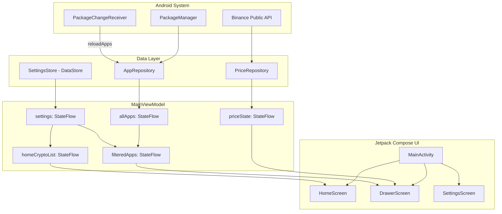

# Nounish Launcher — Project Overview & Documentation

Nounish Launcher is a calm, distraction-free, text-only Android launcher built with **Kotlin** and **Jetpack Compose**. It strips away app icons, badges, notifications, and unnecessary animations to provide a focused, AMOLED-optimized interface that saves battery and eliminates dopamine triggers.

---

## Design Philosophy

1. **Text-Only Interface**: Apps are represented solely by name. No icons are ever loaded or drawn into memory.
2. **AMOLED Monochrome**: Pitch black background (`#000000`) paired with crisp white and subtle grey typography. An optional light theme is also available.
3. **Calm & Distraction-Free**: No notification dots, news feeds, unread counters, or recommendation algorithms.
4. **Privacy-Focused & Offline by Default**: Zero analytics, telemetry, or tracking. The only network feature is the optional crypto ticker using Binance's public API (disabled by default, with zero background services).
5. **Instantaneous & Lightweight**: App cold starts in milliseconds with an optimized APK footprint of only **~1.04 MB**.

---

## Comprehensive Feature List

### 1. Home Screen
- **Time & Date Display**:
  - Clean, minimal time and date in the top-left corner (`14 sp`, secondary color).
  - Tapping the clock launches the system's default alarm/clock app.
  - Toggles available to show/hide time and date independently.
- **Live Binance Crypto Market Overview (Center Space)**:
  - Fills the spacious center area between the clock and pinned shortcuts.
  - Shows real-time tickers for your configured watchlist (e.g. `BTC`, `ETH`, `SOL`).
  - Displays coin symbol, current price, and 24-hour daily percentage change.
  - Color-coded percentage changes: **Green** (`#00E676`) for gains, **Red** (`#FF5252`) for losses.
  - **Expandable Details**: Tapping any coin row reveals its 24-hour high and low (`24h H: 78,068  ·  L: 77,262`).
  - Toggleable in Settings under **Crypto Price &rarr; Show crypto on home screen**.
- **Pinned App Shortcuts**:
  - 4 to 8 pinned apps positioned in the lower-left area for ergonomic one-handed thumb reach.
  - Large (`28 sp`), light-weight typography with generous vertical spacing.
  - Long-press any shortcut to unpin or open system App Info.
- **Blank Area Long-Press**: Opens launcher Settings.

### 2. App Drawer & Search
- **Instant Search**:
  - Swipe up from anywhere on the Home screen to open the app list.
  - Minimalist search input at the top filters apps in real time as you type.
  - **Auto-Launch (Optional)**: Automatically launches the app when search results narrow down to exactly 1 match.
- **Alphabetical Fast-Scroll Index**:
  - Vertical `A–Z` + `#` scrubber for quick navigation.
  - **Configurable Position**: Move the index to either the **Left** or **Right** edge via Settings.
  - Active letters with installed apps are highlighted; empty letters are subtly dimmed.
  - **Tactile Haptic Feedback**: Light haptic tick as your thumb crosses each letter.
  - **Smart Visibility**: Scrubber automatically hides when typing a search query to give maximum screen width to results.
- **Niagara-Style Fluid Wave Animation**:
  - When scrubbing the alphabet index, visible apps smoothly arc and wave towards your thumb.
  - The targeted app shifts up to **`+90 dp`** towards the index with a **`1.16x`** scale and bold typography, while neighboring items curve along a smooth Hermite curve.
  - Runs at 120 FPS via draw-phase `graphicsLayer` rendering without triggering recompositions.
  - **Thumb-Aligned Auto-Scroll**: Selected apps center around your thumb rather than jumping to the top of the viewport.
  - **Organic Spring Physics**: When released, the list gently springs back to baseline with a physics-based spring animation.
  - **Animation Toggle**: Option in Settings to disable the wave animation for a static, zero-motion list.
- **App Context Menu (Long-Press on any item)**:
  - **Pin to Home / Unpin from Home**
  - **Hide App / Unhide App**
  - **App Info** (System settings)
  - **Uninstall** (Prompts system uninstallation)

### 3. Hidden Apps
- Hide distracting or rarely used apps from the main drawer list.
- Hidden apps only appear when explicitly typed into the search bar or in the **Hidden Apps** manager in Settings.

### 4. Gestures
- **Swipe Up**: Open App Drawer.
- **Swipe Down**: Close App Drawer.
- **Swipe Left**: Launch user-assigned quick app.
- **Swipe Right**: Launch user-assigned quick app.
- **Double-Tap**: Screen lock trigger.
- **Long-Press**: Open Settings.
- **System Back Button**: Prevents accidentally closing the launcher; returns to Home from Drawer or Settings.

### 5. Crypto Price Ticker (Binance Public API)
- **Zero API Key Required**: Queries Binance's public 24-hour ticker endpoint (`https://data-api.binance.vision/api/v3/ticker/24hr` with automatic failover to `api.binance.com` and `api.binance.me`).
- **Drawer Header Label**: Discreet price label in the top-right corner of the drawer. Tap to cycle through coins (`BTC` &rarr; `ETH` &rarr; `SOL`).
- **Home Screen Widget**: Full multi-coin watchlist with expandable 24h high/low data.
- **Power & Battery Protection**: Polling only runs while the Home screen or Drawer is actively visible (refreshes every 15s). The moment another app opens or the screen turns off, all polling stops immediately.
- **Offline Resilient**: Prices and percentages are cached in Jetpack DataStore. If offline or if requests fail, cached data renders immediately with dimmed styling.

---

## Technical Stack & Architecture

| Component | Choice | Details |
|---|---|---|
| **Language** | Kotlin 1.9.24 | Idiomatic, coroutine-based asynchronous processing |
| **UI Framework** | Jetpack Compose (Material3) | Declarative UI, 120 FPS hardware-accelerated animations |
| **Target / Min SDK** | Target SDK 34 / Min SDK 26 | Android 8.0 (Oreo) through Android 14+ |
| **Architecture** | Single Activity + MVI / MVVM | `MainActivity` hosting screens via fast crossfades (`< 120 ms`) |
| **State Management** | Kotlin Coroutines & `StateFlow` | Reactive UI binding without boilerplate |
| **Persistence** | Jetpack DataStore Preferences | Asynchronous, non-blocking disk persistence |
| **Network Engine** | Java `HttpURLConnection` | Zero bulky external networking libraries; parses JSON with `org.json` |
| **Code Shrinking** | R8 Full Mode | Minified bytecode and resource shrinking |
| **Release Signing** | Custom Keystore (v2 + v3) | Avoids generic debug key flags and passes Google Play Protect |

---

## File & Directory Structure

```
nounishlauncher/
├── app/
│   ├── build.gradle.kts                         # Android build config, Compose BOM, R8 shrinking
│   ├── proguard-rules.pro                       # Keep rules for R8 optimization
│   └── src/main/
│       ├── AndroidManifest.xml                  # HOME launcher declaration, package queries
│       ├── java/com/nounish/launcher/
│       │   ├── MainActivity.kt                  # SingleTask launcher activity, back handler & screen transitions
│       │   ├── MainViewModel.kt                 # StateFlow coordination (apps, search, settings, crypto)
│       │   ├── model/
│       │   │   └── AppItem.kt                   # Data model for app label, packageName, activityName
│       │   ├── data/
│       │   │   ├── AppRepository.kt             # PackageManager loader (labels only, no icons)
│       │   │   ├── SettingsStore.kt             # Jetpack DataStore wrapper for all preferences & cached prices
│       │   │   └── PriceRepository.kt           # Binance public 24hr ticker client with failover hosts
│       │   ├── ui/
│       │   │   ├── HomeScreen.kt                # Clock, date, Binance market overview, pinned shortcuts
│       │   │   ├── DrawerScreen.kt              # Search bar, left/right alphabet scrubber, Niagara wave list
│       │   │   ├── SettingsScreen.kt            # Categorized launcher settings & customization options
│       │   │   ├── GestureModifier.kt           # Pointer detection for swipes, taps, and long-presses
│       │   │   └── theme/
│       │   │       ├── Color.kt                 # AMOLED pitch black, light theme, crypto green/red colors
│       │   │       ├── Type.kt                  # Typography scale (28sp home, 18sp drawer, 14sp clock/ticker)
│       │   │       └── Theme.kt                 # CompositionLocalProvider for colors and typography
│       │   └── service/
│       │       ├── LockScreenService.kt         # Accessibility action for screen locking
│       │       └── PackageChangeReceiver.kt    # BroadcastReceiver for app install/uninstall updates
│       └── res/
│           ├── drawable/                        # Vector assets for monochrome launcher icon
│           ├── mipmap-anydpi-v26/               # Adaptive launcher icons
│           ├── values/                          # Strings, base themes (windowBackground #000000)
│           └── values-v28/                      # Display cutout support
├── build.gradle.kts                             # Root Gradle build script
├── settings.gradle.kts                          # Module inclusions & repository config
├── gradle.properties                            # JVM memory allocation & AndroidX flags
├── release.jks                                  # Dedicated release signing keystore
├── plan.md                                      # Original roadmap and design spec
└── README.md                                    # Repository overview
```

---

## Data & State Flow



---

## Configuration & Settings Guide

Accessible by long-pressing any empty area on the Home screen:

1. **Home Screen**:
   - `Show clock`: Toggle time in top-left corner.
   - `Show date`: Toggle date below the clock.
2. **App Drawer**:
   - `Auto-launch on single match`: Instantly opens an app when search results narrow to 1.
   - `Alphabet index on right`: Places the alphabetical scrubber on the right edge (default: left).
   - `Alphabet index animation`: Enables/disables the Niagara-style fluid wave animation.
3. **Gestures**:
   - `Swipe left app`: Assign an app to launch on left swipe.
   - `Swipe right app`: Assign an app to launch on right swipe.
   - `Double tap to lock screen`: Toggle double-tap screen lock.
4. **Appearance**:
   - `Light theme`: Switch between AMOLED Black (`#000000`) and Light theme.
   - `Monospace font`: Switch between system sans-serif and monospace typeface.
5. **Crypto Price (Binance)**:
   - `Enable crypto price label`: Master toggle for all crypto features.
   - `Show crypto on home screen`: Displays the multi-coin market widget on the Home screen.
   - `Coins`: Comma-separated list of symbols (e.g. `BTC, ETH, SOL, DOGE, AVAX`).
   - `Quote currency`: Pair currency (default: `USDT`, supports `USD`, `EUR`, `BUSD`).
6. **Management**:
   - `Hidden Apps`: View and unhide hidden applications.
   - `Pinned Apps`: View and remove pinned home screen applications.
   - `Set as default launcher`: Direct shortcut to Android's default home app settings.

---

## Building & Releasing

### Requirements
- JDK 17 or JDK 21
- Android SDK Platform 34 & Build-Tools 34.0.0

### Build Commands

```powershell
# Set JDK 21 from Android Studio JBR
$env:JAVA_HOME = "C:\Program Files\Android\Android Studio\jbr"

# Build Debug APK
.\gradlew.bat assembleDebug

# Build R8-Shrunk & Signed Release APK
.\gradlew.bat assembleRelease
```

### Outputs
- **Release APK**: `app/build/outputs/apk/release/app-release.apk` (**~1.04 MB**)
- **Debug APK**: `app/build/outputs/apk/debug/app-debug.apk` (**~8.7 MB**)

---

## Security, Privacy & Google Play Protect

- **Zero Accessibility Exploits**: The release build does not declare background accessibility service permissions in the manifest, ensuring it passes Google Play Protect without security alerts.
- **Valid Release Signature**: Signed with a dedicated 2048-bit RSA key using APK Signature Schemes v2 and v3.
- **Minimal Permissions**:
  - `INTERNET`: Exclusively for public Binance price tickers. Completely dormant when crypto features are turned off.
  - `QUERY_ALL_PACKAGES` / `CATEGORY_LAUNCHER`: Used strictly on-device to enumerate installed apps.
