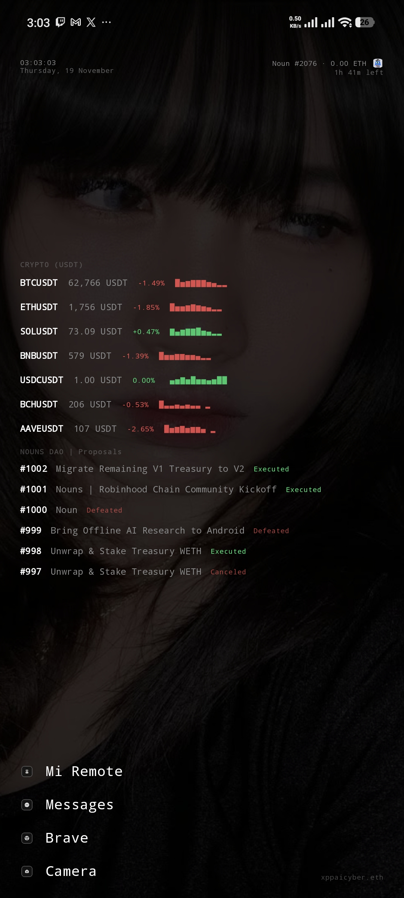
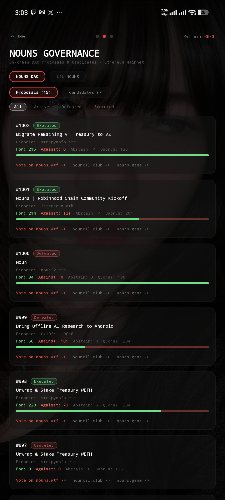
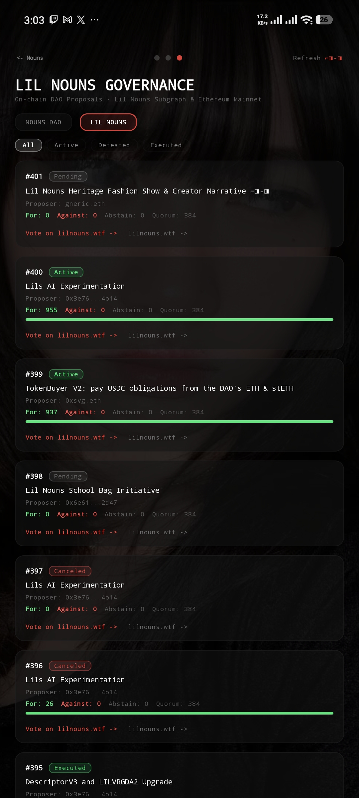
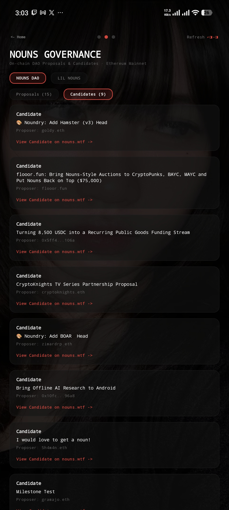
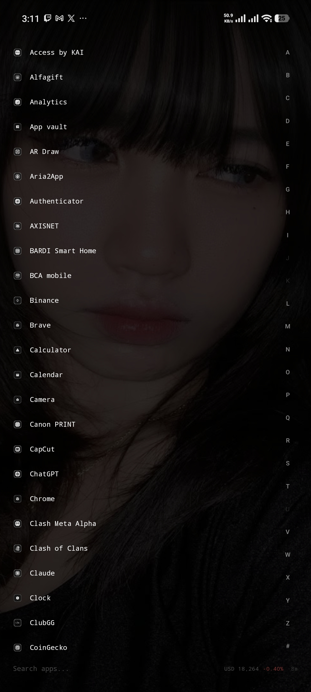
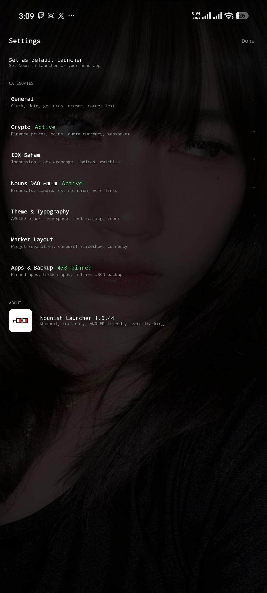

# Nounish Launcher

A calm, distraction-free, text-only Android launcher designed for pure focus and AMOLED battery efficiency. No icons, no widgets, no ads, no telemetry, and offline by default.

**Version**: `1.0.45` (versionCode `46`) · **Release APK Footprint**: `~1.21 MB` (1,273,572 bytes)

---

## Preview

| Home Screen | Nouns Governance | Lil Nouns Governance |
|:---:|:---:|:---:|
|  |  |  |

| Nouns Candidates | App Drawer | Settings Hub |
|:---:|:---:|:---:|
|  |  |  |

---

## Features

### 1. Direct On-Chain Nouns Auction Feed & Integrated Clock Placement
- **Independent Auction & Feed Controls**: The live auction widget operates completely independently from the Home governance feed. Disabling "Show Nouns DAO feed" disables only the middle proposals and candidates cards while leaving the live auction, countdown, highest bid, and pixel-art avatar active and updating in real time.
- **Cardless, Compact Integrated Styling**: Completely integrated with the screen typography (same font size and metrics as the Clock & Date, `14 sp`). No card background, no borders, and no heavy padding, blending natively into AMOLED black.
- **Configurable Widget Placement**:
  - **Below Clock**: Stacks directly beneath the Time and Date on the left side of the screen (`Noun #<id> · <amount>` and countdown timer), keeping all status information unified on the left.
  - **Top Right (Default)**: Positioned opposite the Clock & Date in the top-right corner.
  - Selectable in Settings under **Nouns DAO -> Auction widget position**.
- **Canonical Ethereum Auction House Proxy**: Directly queries the official Nouns Auction House proxy contract [`0x830bd73e4184cef73443c15111a1df14e495c706`](https://etherscan.io/address/0x830bd73e4184cef73443c15111a1df14e495c706) via standard Ethereum JSON-RPC `eth_call`.
- **Method Selector `0x7d9f6db5` (`auction()`)**: Calls the public `auction()` function and decodes all 6 returned ABI fields directly on-device (`nounId`, `amount`, `startTime`, `endTime`, `bidder`, `settled`).
- **Completely Decentralized & Serverless**: Requires zero custom backend, no intermediaries, and no proprietary servers. Includes automatic multi-endpoint RPC fallback (Alchemy Ethereum Mainnet, Cloudflare Ethereum, PublicNode) for 100% uptime and resilience.
- **Official Pixel-Art Noun Image Display (`https://noun.pics/{id}.png`)**:
  - Displays the authentic 64x64 pixel-art avatar for the active auction Noun fetched from `https://noun.pics/{nounId}.png` (e.g. `https://noun.pics/2070.png`).
  - Rendered with `FilterQuality.None` (nearest-neighbor) so every pixel is razor-sharp and punchy on AMOLED screens without blurry bilinear interpolation.
  - Features an inline thumbnail in the integrated auction widget (`18.dp`) and auction row (`28.dp`/`34.dp`), expanding into a generous preview when tapped.
  - Fallback placeholder: Displays the iconic `⌐◨-◨` glasses in a rounded surface box while loading or when offline.
  - Zero Third-Party Bloat: Built with zero heavy image libraries (no Coil, Glide, or Picasso), maintaining the ultra-lightweight ~1.13 MB APK size.
  - Dual-Layer Caching: Cached in memory (`LruCache`) and on local disk storage (`context.cacheDir/noun_pics/`) for instantaneous zero-latency offline loading without burning mobile data.
  - Toggleable in Settings under **Nouns DAO -> Show Noun auction image** for users who prefer pure text mode.
- **AMOLED Distraction-Free Presentation**:
  - Current Token ID: `Noun #<id>` in semi-bold primary tone.
  - Current Highest Bid: Formatted in ETH (e.g. `8.50 ETH`, or `0.00 ETH` if unbid).
  - Dynamic Live Countdown: Real-time countdown timer (`2h 14m left`, `45m 12s left`, `28s left`, or `Settled` / `Auction ended`) updating second-by-second directly derived from the launcher clock without relying on frozen cached strings.
  - Stale Indicator: Muted styling and age marker (`·5m ago`, `·1h ago`) when offline.
- **On-Chain Reverse ENS Resolution & Expandable Bidder**:
  - Resolves bidder addresses to human-readable ENS names (e.g. `vitalik.eth`, `stripymofo.eth`) directly on-chain via the canonical `ReverseRecords` contract (`0x3671aE578E63FdF66ad4F3E12CC0c0d71Ac7510C`) using batch `getNames(address[])` eth_call queries.
  - Fallback display: Displays shortened hexadecimal address (`0x3a41...f91c`) or `No bids` if unbid.
  - Cached in-memory with thread-safe `ConcurrentHashMap` for instant rendering and zero repeated queries.
  - Tap the integrated auction widget or auction row to view the resolved bidder and launch a randomized decentralized Nouns client in the system browser (`nouns.wtf`, `noun.wtf`, or `nouns.game`).
- **Smart Middle Feed De-duplication**: When the live auction is prominently displayed in the top-right corner, the middle Nouns feed intelligently prioritizes governance Proposals and Candidates during auto-rotation, preventing redundant duplicate auctions on screen. Top-right auction updates remain active even when the middle feed is configured for Proposals only or Candidates only.
- **Parallelized On-Chain RPC Queries**: Queries for Auction, Proposals, and Candidates execute concurrently in parallel coroutines, with synchronized `coroutineScope` management ensuring pull-to-refresh indicators remain active until network calls settle.
- **On-Chain Write Transactions Specification**: Full EIP-1193 unsigned payload specification and ABI encoding for `createBid(nounId)` and `settleCurrentAndCreateNewAuction()` detailed in [NOUNS_TRANSACTION_PAYLOAD.md](NOUNS_TRANSACTION_PAYLOAD.md).
- **Offline DataStore Caching**: Caches full auction state in Jetpack DataStore preferences for zero-latency frame-1 presentation on launch.

### 2. Multi-Home Screen & Full-Screen Governance Proposals Space (Nouns & Lil Nouns DAO)
- **3-Screen Horizontal Slide Architecture**: Seamless hardware-accelerated horizontal navigation across Home (Page 1), Nouns DAO Governance (Page 2), and Lil Nouns DAO Governance (Page 3).
- **Interactive Page Indicator Dots & DAO Switcher Pills**: Top navigation features interactive indicator dots for one-tap screen switching and quick DAO switcher pills (`NOUNS DAO` | `LIL NOUNS`).
- **Nouns DAO Full-Screen Governance**: Dual tabs for active proposals and community candidates, real-time status filtering (All, Active, Defeated, Executed), visual voting ratio bars, reverse ENS proposer names, and direct voting links (`nouns.wtf`, `nouncil.club`, `nouns.game`).
- **Lil Nouns DAO Full-Screen Governance**: Dedicated full-screen space querying the Goldsky Subgraph (`lil-nouns-subgraph/1.0.10/gn`) with multi-RPC fallback to Ethereum Mainnet (`0x5d2C31ce16924C2a71D317e5BbFd5ce387854039`). Displays proposal titles, status badges (Active and Executed in green, Defeated/Canceled in red), reverse ENS proposer resolution, quorum statistics, visual voting bars, and direct voting actions linking to `https://lilnouns.wtf/vote/{id}`.
- **Lazy Loading of Historical Proposals**: Scrolling to the bottom automatically paginates and lazily loads older on-chain proposals for both DAOs.
- **Animated Noggles Loading Indicator**: While loading older items at the bottom, an animated `⌐◨-◨` indicator types character-by-character with organic breathing scaling, pulsing alpha, and cycling progress dots in the user's accent color.
- **Top-Right Noggles Refresh Button**: The top-right refresh action displays `Refresh ⌐◨-◨` when idle and pulses with animated breathing noggles (`Syncing... ⌐◨-◨`) while syncing from the blockchain.
- **Direct Web3 Voting Actions**: One-tap links (`Vote on nouns.wtf ->`, `nouncil.club ->`, `nouns.game ->`, and `Vote on lilnouns.wtf ->`) open verified decentralized governance frontends directly in the browser.
- **Dedicated Top Navigation Bar**: Clean `<- Home` and `<- Nouns` navigation bars with quick on-chain refresh on governance screens.
- **Ergonomic Gesture Navigation**: Swipe right returns to the previous screen (Lil Nouns -> Nouns -> Home), swipe down to pull-to-refresh on-chain data, double-tap to lock screen, or long-press to open Settings. The App Drawer is intentionally disabled on governance screens to ensure uninterrupted vertical list scrolling even when swiping near corners.
- **Dedicated Default Gestures**: Swipe left on Home defaults directly to opening fullscreen Governance proposals, cleanly toggleable in Settings under **Gestures -> Swipe left** or **Nouns DAO -> Second home screen (Governance)** and **Third home screen (Lil Nouns DAO)**.
- **Lil Nouns Digest Swipe-Right Gesture**: Swipe right on Home slides directly into the Lil Nouns Digest timeline screen, displaying real-time on-chain votes, proposals created, voting active, closing soon, delegations, and auctions. Toggleable in Settings under **Gestures -> Swipe right** and **Nouns DAO -> Swipe right gesture (Lil Nouns Digest)**.

### 3. Lil Nouns Digest Activity Timeline (Swipe Right)
- **Live On-Chain Activity Feed**: Pulls live timeline activity directly from `https://db.lilnouns.wtf/api/digest` with automatic fallback to Goldsky Subgraph (`GetDigestCore`).
- **Category Filter Chips**: Filter events on the fly with smooth horizontal chips: `All`, `Votes`, `Proposals`, and `Delegations`.
- **Transparent Delegation & Identity Clarity**: Delegations display explicit `From: <delegator> -> To: <delegatee>` relationships (or `-> Undelegated`), specific delegated Lil Noun token IDs (e.g. `Lil #6887, #6258, #4357`), and on-chain reverse ENS names for both accounts, completely eliminating ambiguous raw "actor" labels.
- **On-Chain Reverse ENS Resolution**: Actor and voter Ethereum addresses resolve to human-readable ENS domains (e.g. `stripymofo.eth`, `vitalik.eth`) via the canonical Ethereum `ReverseRecords` contract.
- **Direct Web3 Action Links**: One-tap links open live proposals and actions directly on `https://lilnouns.wtf/vote/{id}` and `https://lilnouns.wtf/digest`.
- **Infinite Scroll Cursor Pagination**: Bottom scrolling automatically loads older activity events using cursor pagination.
- **Animated Noggles Refresh & Loading**: Features breathing `⌐◨-◨` loaders when paginating and syncing fresh on-chain activity.
- **Ergonomic Slide Transitions**: Seamless spatial slide-in from the left on swipe-right, with swipe-left or back tap returning to Home.

### 4. Signature Nounish Aesthetics & Accent Colors
- **Official Nouns Glasses App Icon**: Features the canonical Nouns DAO glasses brandmark (`glasses-square-black-eyes-red`: black square frames, crisp white eyes, and vibrant red pupils) set against a high-contrast white adaptive background. Built as an exact 16x6 pixel-grid vector centered symmetrically within Android's 72dp adaptive safe zone to prevent edge clipping under all OEM launcher shapes (circle, squircle, round rectangle). Includes Android 13+ Themed Icon monochrome support and multi-density legacy mipmaps.
- **Signature Nounish Accent Color Palettes**: Choose from 6 curated palettes to personalize your experience while maintaining AMOLED elegance:
  - **Pure Monochrome**: Crisp white (`#FFFFFF`) on AMOLED Black / Deep graphite (`#121212`) in Light Theme.
  - **Nounish Red `⌐◨-◨`**: Iconic vibrant red (`#E53935`).
  - **Warm Amber**: High-contrast golden amber (`#FFB300`).
  - **AMOLED Mint Green**: Vivid, battery-saving green (`#00E676`).
  - **Muted Slate**: Calm slate blue (`#90A4AE` in Dark / `#546E7A` in Light).
  - **Soft Lavender**: Soothing pastel lavender (`#B39DDB` in Dark / `#7E57C2` in Light).
- **Targeted Accent Tinting**: The selected accent color subtly and cohesively tints key interactive elements throughout the launcher:
  1. **Breathing & Typing Glasses**: The iconic `⌐◨-◨` glasses during Home pull-to-refresh.
  2. **Active Carousel Tabs**: Highlighted category headers (`CRYPTO (USDT)`, `IDX SAHAM (IDR)`, `NOUNS DAO ⌐◨-◨`).
  3. **Passive Learning Note Title**: The `NOUNISH ⌐◨-◨` card header on Home.
  4. **Math Calculation Result**: The clean `= <result>` text banner in the App Drawer search.
  5. **Alphabet Index Scrub Highlights**: The active hovered letter indicator and the targeted app waving out during alphabetical scrubbing.
  6. **Search Text Cursor**: The active text input cursor in the App Drawer.
  7. **Settings Category Pills**: Active selector pill border, background tint, and label text in Settings.
  8. **Switch Toggles**: Checked switch track color across all settings toggles.

### 5. Customizable Haptic Feedback Intensity
- **4 Distinct Feedback Levels**: Fine-tune tactile feedback across the launcher:
  - **Standard**: Balanced tactile ticks for navigation and firm long-press triggers.
  - **Subtle (Light Tick)**: Gentle, understated micro-ticks across all interactions.
  - **Firm (Strong)**: Pronounced, confident vibration feedback.
  - **Off (Disabled)**: Completely silent, vibration-free operation.
- **Universal Application**: Seamlessly integrated across pull-to-refresh resistance milestones, gesture triggers (swipe down, screen lock), alphabet index scrubbing (tick on each letter crossed), and one-tap clipboard copy actions.

### 6. Wallpaper Change Support & AMOLED Dark Scrim
- **Wallpaper Change Options**: Update the system wallpaper directly from Settings without leaving the launcher:
  - **Gallery / Photos Picker**: Select any photo with native crop-and-set intent (`WallpaperManager.getCropAndSetWallpaperIntent`) and direct bitmap stream fallback.
  - **System Wallpaper & Style Picker**: Direct shortcut to Android's native wallpaper chooser (`Intent.ACTION_SET_WALLPAPER`).
- **AMOLED Dark Scrim Overlay**: Pair device wallpaper with a customizable dark scrim overlay (adjustable from **50% to 95%**, default **80%**) to ensure typography remains crisp, legible, and AMOLED-friendly over any image.

### 7. Window Hardware Alpha Compositing Architecture (Zero-Ghosting)
- **RGBA_8888 Translucent Window Surface**: Explicitly configured via `window.setFormat(PixelFormat.TRANSLUCENT)`, ensuring Android's SurfaceFlinger hardware compositor blends window pixels directly with the wallpaper layer without color-depth reduction or banding artifacts.
- **Window Translucency & Wallpaper Flags**: Configured with `android:windowIsTranslucent = true` and `android:windowShowWallpaper = true` in window styles with transparent backgrounds, allowing hardware-accelerated wallpaper presentation.
- **Static Root Scrim Layer**: The root `Surface` applies `LauncherTheme.colors.background` (using `Color.Black.copy(alpha = dimAlpha)` or `#000000`) as a single, static compositing layer. Child screens (Home, Drawer, Settings) render on transparent surfaces, eliminating double-scrim multiplication and preventing background darkening during transitions.
- **`AnimatedContent` Sequential Transitions**: Screen transitions utilize `AnimatedContent` with `fadeIn(tween(120))` together with `fadeOut(tween(90))`. Screen composables are cleanly disposed upon exit rather than overlapping simultaneously, guaranteeing **zero ghosting, no lingering text afterimages**, and silky-smooth 120 FPS transitions.

### 8. App Drawer, Search & Ergonomics
- **Recent Apps**: Displays your most recently used apps in a clean, scrollable horizontal row of pills at the top (or anchored above the bottom search bar for instant one-handed reach). Automatically tracks up to 5 launched apps with LRU deduplication and hides seamlessly when searching.
- **Inline Minimalist Calculator**: Type arithmetic expressions directly into the search bar (`125 * 8`, `45000 / 12`, `(15 + 5) * 4`, `25% * 80`, `2^8`, `100 - 15%`) to calculate in real time. Displays a clean `= <result>` row in your chosen accent color with one-tap copy to clipboard, subtle "Copied" confirmation, tactile haptic feedback, and zero interference with normal app searching.
- **Deep App Shortcuts (Android 7.1+)**: Long-pressing any app on Home or Drawer queries dynamic, manifest, and pinned shortcuts via native `LauncherApps.getShortcuts()` (e.g. Chrome's "New Tab", chat conversations). Displayed as clean AMOLED text rows above standard options for instant one-tap launch.
- **Multi-Activity & Work Profile Support**: Uses Android's native `LauncherApps` API to display and launch both personal and work profile apps (`(Work)`) with independent user handles. Apps with multiple launcher activities are identified by unique composite keys (`packageName/activityName`).
- **Accent- & Case-Insensitive Alphabetical Sorting**: Unicode NFD normalization strips combining marks so `Écran` and `Über` sort under `E` and `U`. Numbers and symbols (`1Password`, `7-Zip`, `@voice`) are cleanly grouped under `#` at the end.
- **Bottom Search Bar Option**: Anchor the search input bar (and live USD/IDR ticker) at the **Top** or **Bottom** of the drawer for optimal one-handed reachability on modern tall displays.
- **Live USD/IDR Rate**: Real-time USD to Indonesian Rupiah exchange rate inside the drawer with one-tap tactile refresh and stale-data indicators. Toggleable in Settings.
- **Alphabetical Fast-Scroll Index**: Vertical `A–Z` + `#` index scrubber on either the **Left** or **Right** edge with tactile haptic ticks as you scrub.
- **Matching App Highlighting & Non-Matching Dimming**: When scrubbing the alphabet index, matching apps are highlighted in bold typography and accent color, while non-matching apps and icons gracefully dim to muted grey (`0.28` alpha) to keep the list clean and readable.
- **Niagara-Style Fluid Wave Animation**: When scrubbing the alphabet index, apps smoothly curve and wave towards your thumb with organic spring physics at 120 FPS. Toggleable in Settings for a completely static list.
- **App Context Menu**: Long-press any app to access deep shortcuts, Rename, Pin/Unpin, Hide/Unhide, App Info, and Uninstall.

### 9. Home Screen Essentials
- **Pinned App Management & Split Bottom Layout**: Pin up to 8 apps (0–8 freely configurable) in large (`28 sp`) light-weight typography positioned in the lower-left area for ergonomic thumb reach. Click targets strictly wrap the app icon and label so tapping the empty right side never launches an app.
- **System Navigation Bar Inset Protection**: Integrated `navigationBarsPadding()` combined with dedicated touch padding (`20.dp`) ensures pinned shortcuts and bottom-right widgets never overlap with Android's system navigation bar (3-button navigation or gesture pill) across any display configuration.
- **Dedicated Up/Down Reordering**: Reorder pinned shortcuts directly in Settings -> Pinned Apps with dedicated up (`↑`) and down (`↓`) controls without unpinning and re-pinning.
- **Clean Uninstall Pruning**: Automatically drops uninstalled apps from pinned shortcuts and DataStore, leaving zero dead entries.
- **Clock & Date Customization**: Choose between System Default (respects Android's 24-hour setting), 24-hour (`HH:mm`), 12-hour with AM/PM (`h:mm a`), or 12-hour without AM/PM (`h:mm`). Includes optional live seconds (`:ss`) and selectable date format presets (`Full`, `Short`, `Standard with year`, `ISO 8601`, `US style`, `Compact`) or custom `SimpleDateFormat` patterns. Tapping the clock launches the system alarm/clock app.
- **Custom Corner Text (Bottom Right)**: Display custom text (such as your username, handle, or motivational quote) in the bottom-right corner of the Home screen, styled in muted secondary tone. Configurable in Settings (default: `xppaicyber`) or toggled off completely.
- **Passive Learning Notes (Top Right or Bottom Right)**: Minimalist card featuring the ethos of Nounish `⌐◨-◨` ("do good with no expectation of return, create positive externalities, embrace absurdity & difference, teach people about nouns & crypto, have fun and be honest. - PIP3"), with tap-to-cycle bites of crypto culture and web3 terminology. Free of distracting swap or dismiss buttons. Tapping the card cycles smoothly to the next tip. Fully configurable in Settings (`Top right (Default)` or `Bottom right` split alongside pinned apps).
- **Currency Format**: Real-time market prices clearly specify currency format across tickers, headers, and ranges—using `USDT` for Crypto (e.g. `68,450 USDT`) and `IDR` for IDX Saham (e.g. `9,850 IDR`). Configurable in Settings (Suffix, Prefix, or None).

### 10. Live Market & Community Feeds
- **Live Binance Crypto Market Overview**: Real-time tickers, current prices, 24-hour daily percentage change, text sparklines (` ▂▃▄▅▆▇█`), and expandable 24h high/low (`H: 78,068 · L: 77,262`). Supports custom watchlists (`BTC`, `ETH`, `SOL`, `PEPE`, `BTCUSDT`, `ETHBIDR`) and quote currencies (`USDT`, `USDC`, `EUR`, `BIDR`, `TRY`, `BRL`, `GBP`, `AUD`, `BTC`).
- **Indonesian Stock Exchange (IDX Saham)**: Live IDX quotes (`https://idx.xpp.wtf/`) with modes for Auto Rotate, Market Indices (`IHSG`, `LQ45`), Top Gainers, Top Losers, or Custom Watchlist (`BBCA`, `BBRI`, `BMRI`, `TLKM`, `ASII`, `GOTO`), complete with expandable 24h high/low and volume on tap.
- **Auto-Rotating IDX Categories with Staggered Wave Transition**: In Auto Rotate mode, the IDX view smoothly cycles through categories every 6 seconds. Each transition features a staggered wave animation where stock rows slide 1 by 1 to the left with dynamic descriptive headers.
- **Nouns DAO Governance & Candidates Feed (100% On-Chain RPC)**: Live Nouns DAO governance proposals and candidate proposals queried directly from the Ethereum Mainnet DAO Proxy (`0x6f3E6272A167e8AcCb32072d08E0957F9c79223d`) and Candidate (`0xf790A5f59678dd733fb3De93493A91f472ca1365`) contracts via JSON-RPC batch calls—with zero intermediate backend API dependency. Displays pure text rows (`#1002 Title Status`) with color-coded status badges, proposer addresses resolved to reverse ENS names (e.g. `stripymofo.eth`), live voting quorum statistics (`For`, `Against`, `Quorum`), and direct browser voting links (`Vote ↗`).
- **Separated Views vs. Auto-Rotating Carousel**: Choose whether Crypto, IDX Saham, and Nouns DAO display simultaneously (Stacked vertically or Multi-column side by side) to maximize screen space, or rotate within a single center carousel with customizable slide/crossfade transitions.
- **Manual Pull-to-Refresh (Breathing & Typing ⌐◨-◨)**: Swipe down anywhere on Home to trigger an instantaneous refresh across all active market feeds. Features an organic pull interaction where the iconic `⌐◨-◨` glasses dynamically type out as your finger pulls down, accompanied by tactile haptic feedback. While data is being fetched, the glasses pulse with an organic breathing animation and character typing loop. When enabled, automatic background polling is paused to conserve battery and bandwidth.
- **Stale-Data Indicators & Network Awareness**: When offline or displaying cached prices, values dim and display a subtle age marker (`·now`, `·5m`, `·1h`). Automatically stretches poll intervals on cellular data or battery saver mode, with exponential backoff on HTTP 429 rate limits.
- **Optional Live WebSocket on Home**: Stream live real-time Binance ticks directly on Home via native RFC 6455 WebSocket client, cleanly closed when leaving Home or locking the screen.

### 11. Gestures & Customization
- **Swipe Up**: Open App Drawer.
- **Swipe Down on Home**: Fully configurable in Settings:
  - **Manual refresh** (default): Refreshes market and Nouns data with breathing/typing `⌐◨-◨` glasses (pauses background polling).
  - **Open notification shade**: Pulls down the system notification shade from anywhere on Home.
  - **Open App Drawer**: Opens instant search.
  - **Disabled**: Prevents swipe-down action.
- **Swipe Down in Drawer**: Close App Drawer.
- **Swipe Left**: Open fullscreen Governance proposals (Nouns DAO secondary home screen).
- **Swipe Right**: Open Lil Nouns Digest timeline (live votes, proposals, delegations) or launch optional user-assigned quick app.
- **Double-Tap**: Screen lock.
- **Long-Press Background**: Open Settings.
- **System Navigation Support (Gestures & 3-Button)**: Fully compatible with Android 10+ gesture navigation and legacy 3-button navigation. Features official Android 13/14+ Predictive Back gesture animations (`enableOnBackInvokedCallback="true"`) and zero-contrast transparent bars (`enforceNavigationBarContrast="false"`). Includes a direct System Navigation action in Settings -> Gestures to open the device's navigation settings.
- **Full-Screen Gesture Mode**: Toggleable setting in Settings -> Gestures that hides the system navigation bar for an immersive edge-to-edge experience across all launcher screens, allowing pinned apps and widgets to expand to full height while preserving transient swipe gesture access.
- **Minimalist App Icons & Monochrome Filter**: Display subtle icons beside apps in Home and Drawer, apply an AMOLED monochrome/grayscale filter, or disable icons entirely for pure text mode.
- **Custom App Renaming**: Assign custom aliases to any app (e.g. "Chrome" -> "web", "Spotify" -> "music") with one-tap reset.
- **Hidden Apps**: Hide distracting apps from the drawer; access them via search or Settings -> Hidden Apps.
- **Offline Settings Backup & Restore (JSON)**: Export and import pinned apps, hidden apps, custom labels, and preferences as an offline JSON file via Android Storage Access Framework (`CreateDocument` / `OpenDocument`). 100% on-device and private.

---

## Tech Stack & Architecture

| Layer | Component | Details |
|---|---|---|
| **Language** | Kotlin 1.9.24 | Coroutines, Flow, StateFlow, immutable data models |
| **UI Toolkit** | Jetpack Compose (Material3) | Compose BOM `2024.04.01`, hardware-accelerated 120 FPS rendering |
| **Android SDK** | Min SDK 26 · Target SDK 34 · Compile SDK 34 | Android 8.0 (Oreo) through Android 14+ |
| **Architecture** | Single Activity + MVI / MVVM | `MainActivity` coordinating `MainViewModel`, immutable StateFlows |
| **Compositing** | Hardware Alpha Compositing | `PixelFormat.TRANSLUCENT` (RGBA_8888), `windowIsTranslucent`, static root scrim layer, `AnimatedContent` transitions |
| **Haptics** | `LauncherHaptic` Utility | 4 configurable intensity levels (`Standard`, `Subtle`, `Firm`, `Off`) |
| **Calculator** | `MathEvaluator` Engine | Zero-dependency recursive descent parser for arithmetic expressions |
| **Shortcuts** | Android `LauncherApps` API | Deep app shortcuts querying (dynamic, manifest, pinned) for Android 7.1+ |
| **Storage & Persistence** | Jetpack DataStore Preferences | Asynchronous, thread-safe disk persistence for settings and cached data |
| **Document Access** | Android Storage Access Framework (SAF) | Permissionless, offline JSON backup and restore (`CreateDocument` / `OpenDocument`) |
| **Networking** | Java `HttpURLConnection` & RFC 6455 `SSLSocket` | Zero external network libraries; `org.json` parser; WebSocket client |
| **Footprint & Optimization** | R8 Full Mode & Resource Shrinking | Minified bytecode; **~1.18 MB** release APK (1,242,061 bytes) |

---

## Project Structure

```
nounishlauncher/
├── app/
│   ├── build.gradle.kts                         # Android build config, Compose BOM, R8 shrinking
│   ├── proguard-rules.pro                       # R8 optimization and keep rules
│   └── src/
│       ├── main/
│       │   ├── AndroidManifest.xml              # HOME launcher declaration, permissions, <queries>
│       │   ├── java/com/nounish/launcher/
│       │   │   ├── MainActivity.kt              # SingleTask activity, SAF backup/restore, screen transitions
│       │   │   ├── MainViewModel.kt             # StateFlow coordination (apps, search, settings, crypto, labels)
│       │   │   ├── model/
│       │   │   │   ├── AppItem.kt               # App item model (labels, composite keys, user handles)
│       │   │   │   ├── AppShortcut.kt           # Deep shortcut model (dynamic, manifest, pinned)
│       │   │   │   └── PassiveNote.kt           # Passive learning notes model and Nounish definitions
│       │   │   ├── data/
│       │   │   │   ├── AppRepository.kt         # PackageManager & LauncherApps loader, deep shortcuts
│       │   │   │   ├── SettingsStore.kt         # Jetpack DataStore wrapper, JSON backup/restore serialization
│       │   │   │   ├── PriceRepository.kt       # Binance 24hr ticker, sparklines, rate-limit backoff
│       │   │   │   ├── IdxRepository.kt         # IDX stock quotes, indices, top gainers/losers, formatting
│       │   │   │   ├── NounsRepository.kt       # Nouns DAO governance proposals & candidates loader
│       │   │   │   ├── LilNounsRepository.kt    # Lil Nouns DAO subgraph & Ethereum RPC proposals loader
│       │   │   │   ├── BinanceWebSocketClient.kt# Native RFC 6455 WebSocket client for live Home stream
│       │   │   │   ├── IconCache.kt             # LRU memory cache for app icons
│       │   │   │   └── NetworkHelper.kt         # Metered network and battery saver detection
│       │   │   ├── ui/
│       │   │   │   ├── HomeScreen.kt            # Clock, date, market overview, text sparklines, pinned apps
│       │   │   │   ├── GovernanceScreen.kt      # Full-screen Nouns DAO governance proposals & candidates space
│       │   │   │   ├── LilGovernanceScreen.kt   # Full-screen Lil Nouns DAO governance proposals space
│       │   │   │   ├── DrawerScreen.kt          # Search bar, recent apps, calculator row, Niagara wave index
│       │   │   │   ├── SettingsScreen.kt        # Settings hub, accent dialog, wallpaper, haptic level, SAF
│       │   │   │   ├── GestureModifier.kt       # Gesture detection for swipes, taps, and long-presses
│       │   │   │   └── theme/
│       │   │   │       ├── Color.kt             # AMOLED pitch black, accent colors (Red, Amber, Mint, Slate, Lavender)
│       │   │   │       ├── Type.kt              # Typography scale (28sp home, 18sp drawer, 14sp ticker)
│       │   │   │       └── Theme.kt             # Dynamic Compose theme provider and static scrim background
│       │   │   ├── util/
│       │   │   │   ├── LauncherHaptic.kt        # Multi-level haptic feedback dispatcher (Standard, Subtle, Firm, Off)
│       │   │   │   └── MathEvaluator.kt         # Zero-dependency arithmetic tokenizer & recursive descent evaluator
│       │   │   └── service/
│       │   │       ├── LockScreenService.kt     # Screen lock accessibility action
│       │   │       ├── NotificationHelper.kt    # Notification shade expansion via StatusBarManager reflection
│       │   │       └── PackageChangeReceiver.kt # BroadcastReceiver for app install/uninstall updates
│       │   └── res/
│       │       ├── drawable/                    # Vector assets (ic_launcher_foreground/background, app_logo)
│       │       ├── mipmap-anydpi-v26/           # Adaptive launcher icons with monochrome theming
│       │       ├── mipmap-*/                    # Multi-density legacy launcher icons (mdpi, hdpi, xhdpi, xxhdpi, xxxhdpi)
│       │       ├── values/                      # Strings and window themes (windowIsTranslucent, transparent)
│       │       └── values-v28/                  # Display cutout support and window themes
│       └── test/java/com/nounish/launcher/
│           ├── AestheticsAndHapticsTest.kt      # Accent color mappings, default settings, haptic null-safety
│           ├── AppShortcutTest.kt               # Deep shortcuts rank sorting, label fallbacks, filtering
│           ├── MathEvaluatorTest.kt             # Arithmetic operations, precedence, decimals, safety checks
│           ├── NounsAuctionTest.kt              # Nouns auction ABI decoding, ENS resolution, countdown, card position
│           ├── RecentAppsAndWallpaperTest.kt    # Recent apps LRU history, wallpaper dim level coercion
│           └── SwipeDownActionTest.kt           # Swipe down gesture actions mapping and defaults
├── build.gradle.kts                             # Root Gradle build script
├── settings.gradle.kts                          # Module inclusion & repository management
├── gradle.properties                            # JVM memory allocation & AndroidX settings
├── PLAY_STORE_COMPLIANCE_GUIDE.md               # Google Play Store compliance, package visibility & publishing guide
└── PROJECT_OVERVIEW.md                          # In-depth architectural & technical documentation
```

---

## Unit Test Suites

The project features a dedicated suite of unit tests verifying core logic, math evaluation, deep shortcuts, haptics, and aesthetics:

1. **`MathEvaluatorTest`**: Validates the zero-dependency recursive descent parser across arithmetic operations (`+`, `-`, `*`, `/`, `^`, `%`), operator precedence, parentheses, decimals, postfix percentages, division-by-zero safety, modulo-by-zero safety, and app search query discrimination.
2. **`AppShortcutTest`**: Tests Android 7.1+ deep shortcut data models, short/long label fallback resolution, enabled status filtering, rank sorting, and shortcut list capping.
3. **`AestheticsAndHapticsTest`**: Verifies signature accent color key-to-color mappings across Dark and Light themes, default aesthetic preferences, and null-safe haptic dispatcher execution across all 4 levels (`Standard`, `Subtle`, `Firm`, `Off`).
4. **`RecentAppsAndWallpaperTest`**: Verifies recent apps history LRU deduplication, capacity capping (up to 5 items), and wallpaper dark scrim level coercion (`0.2f` to `0.98f`).
5. **`SwipeDownActionTest`**: Verifies swipe-down gesture action mappings (`notifications`, `refresh`, `drawer`, `none`) and default actions.
6. **`NounsAuctionTest`**: Validates on-chain Nouns auction ABI decoding, ENS reverse lookup batching, real-time countdown formatting, card placement settings, and middle feed de-duplication.

Run all unit tests via Gradle:
```powershell
$env:JAVA_HOME = "C:\Program Files\Android\Android Studio\jbr"
.\gradlew.bat test
```

---

## Building & Running

### Prerequisites
- JDK 17 or JDK 21 (e.g. from Android Studio JBR: `C:\Program Files\Android\Android Studio\jbr`)
- Android SDK Platform 34 & Build-Tools 34.0.0

### Build Debug APK
```powershell
$env:JAVA_HOME = "C:\Program Files\Android\Android Studio\jbr"
.\gradlew.bat assembleDebug
```
Output: `app/build/outputs/apk/debug/app-debug.apk` (~8.7 MB)

### Build Optimized Release APK
```powershell
$env:JAVA_HOME = "C:\Program Files\Android\Android Studio\jbr"
.\gradlew.bat assembleRelease
```
Output: `app/build/outputs/apk/release/app-release.apk` (**~1.21 MB** / 1,273,572 bytes)

### Build Android App Bundle (.aab) for Google Play
```powershell
$env:JAVA_HOME = "C:\Program Files\Android\Android Studio\jbr"
.\gradlew.bat bundleRelease
```
Output: `app/build/outputs/bundle/release/app-release.aab`

For step-by-step Google Play publishing requirements, package visibility compliance, Data Safety declarations, and privacy policy templates, see [PLAY_STORE_COMPLIANCE_GUIDE.md](PLAY_STORE_COMPLIANCE_GUIDE.md).

### Automated CI / GitHub Releases
A GitHub Actions workflow (`.github/workflows/release.yml`) automatically builds the signed, minified release APK and attaches it to GitHub Releases whenever a git tag is pushed:
```bash
git tag v1.0.24
git push origin v1.0.24
```

---

## Privacy & Permissions

- **`INTERNET`**: Used solely for optional public market tickers (Binance public market data, IDX mirror, and Nouns DAO feeds). Completely inert when crypto, IDX, and Nouns features are toggled off.
- **`ACCESS_NETWORK_STATE`**: Used strictly on-device to check for mobile data vs Wi-Fi to stretch polling intervals.
- **`EXPAND_STATUS_BAR`**: Standard normal-level Android permission enabling the swipe-down gesture to expand the system notification shade.
- **`SET_WALLPAPER`**: Standard normal-level Android permission enabling setting the system wallpaper when chosen via Gallery or the system wallpaper picker.
- **Package Visibility (`<queries>`)**: Uses Android 11+ `<queries>` matching `CATEGORY_LAUNCHER` and `LauncherApps` API. Does not request broad `QUERY_ALL_PACKAGES` permission, ensuring full compliance with Google Play Store policies.
- **Zero tracking, zero analytics, zero external logging, zero telemetry.**
